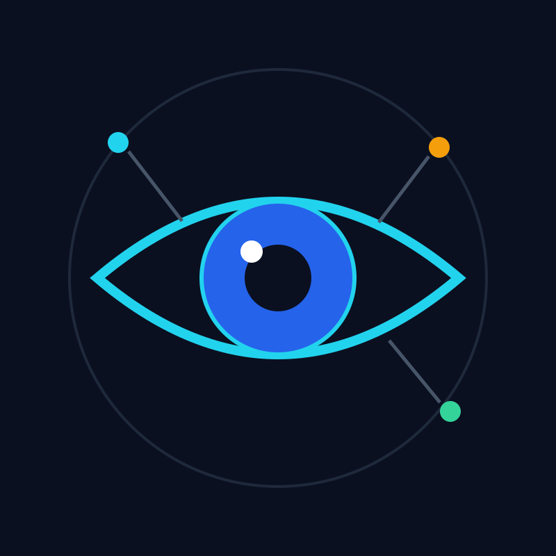

# ARGUS — Multimodal Intelligence Engine

<p align="center">
  
</p>

> Logo drawn with the `pentool` vector binary — every path above is hand-placed
> vector geometry in [`assets/argus-logo.pen`](assets/argus-logo.pen)
> (exports: [`public/logo.svg`](public/logo.svg), [`public/logo.png`](public/logo.png)).
> The eye is Argus the all-seeing; the three dots are data sources fusing into one vision.

> Built for the **Meta AI Hackathon**: an engine that turns many data sources
> into reusable, evidence-backed data products — powered by Meta AI models.

Connect your sources, and ARGUS gives you charts, widgets, alerts and datasets.
Vision is the first source, not the only one: cameras, files, weather APIs,
sensors and webhooks all become one thing — an **Observation** — that can be
fused, reasoned over, and published as a data product.

The guiding rules: **everything becomes an Observation; models propose,
deterministic code computes; the manifest is the contract.**
See [docs/ROADMAP.md](docs/ROADMAP.md) for the full plan and
[public/ARGUS_Visual_Data_Products_Whitepaper_v0.1.pdf](public/ARGUS_Visual_Data_Products_Whitepaper_v0.1.pdf)
for the L0–L6 product ladder.

---

## The demo story: Bridge Intelligence

One narrow story, built end to end: a camera flags a possible crack on a bridge
pier. ARGUS checks inspection history, vibration readings and weather, then
emits an **evidence-backed alert** — frame crop, vibration chart, rain total,
last inspection, confidence and limitations — queued for human review
(approve / dismiss). A working fused alert with visible provenance beats a wide
but hollow source list.

From the Overview page, **"Load sample bridge data"** replays this story
instantly with no hardware.

## How it works

Every connector, no matter the source, writes the same record to the
`observations` table (source, event time, arrival time, location, entity,
payload, confidence, provenance). Fusion and products read only this table.

```
Sources → Observations → Fusion → Agents → Products / Widgets
```

1. **Sources** (`src/sources/`) — connectors for files (CSV/JSON/images via
   Meta vision), Open-Meteo weather, a labelled-simulated vibration sensor and
   a webhook (`POST /api/ingest/[sourceId]`, `x-ingest-key`). Real RTSP/MQTT/
   database connectors are marked Roadmap.
2. **Fusion** (`src/lib/fusion.ts`) — time-window joins (±N s on event time),
   entity matching via the `assets` + alias table, spatial links, and
   `evidence` rows tying every derived result to its inputs.
3. **Agents** (`src/lib/agents/orchestrator.ts`) — a typed pipeline:
   correlation → rule-based severity → Meta reasoning → claim verification
   (every number must appear in stored observations) → pending alert for a
   human. The LLM explains; plain code counts.
4. **Flows** (`src/lib/flow/`, Dashboard → Flows) — an editable production
   line: plain-JSON node graphs (source, filter, fuse, agent, factcheck,
   chart, publish…) that people edit visually and AI edits through the API.
   Includes **Draft with AI**, powered by Meta models. See
   [docs/FLOWS.md](docs/FLOWS.md).
5. **Products & widgets** (`src/products/`, `src/widgets/`) — a manifest
   registry (30 products, 4 specified) plus a widget library; each product
   reads observations and renders dashboards, APIs or datasets.

Infrastructure stays boring on purpose: Postgres (Supabase) is both store and
job queue (`FOR UPDATE SKIP LOCKED`, no Redis, no Kafka until a measured
problem demands it).

## Key features

- Better Auth sign-in with demo users, plus project workspaces
- Source Hub: connect and monitor sources, health and last-seen
- Observations stream, fused Alerts with evidence panel, human review queue
- Flows node editor with AI drafting and deterministic fact-checking
- Data-product enablement per project; publish dashboards / APIs / datasets
- Meta-model assistant with database tools
- Read-only admin console at `/dashboard/admin`
- S3 file uploads; Drizzle migrations for
  `observations` / `assets` / `jobs` / `alerts` / `evidence`

## Tech stack

Next.js 16 · React 19 · Bun · Tailwind CSS 4 + shadcn · Drizzle ORM +
Postgres (Supabase) · Better Auth · Meta AI models (OpenAI-compatible API
via the AI SDK) · Recharts · xyflow · MCP server support

## Getting started

```bash
bun install
cp .env.example .env.local   # fill in DATABASE_URL, Meta API keys, etc.
bun run db:push              # create tables (or db:migrate)
bun run db:seed              # demo users + sample bridge data (optional)
bun run dev                  # open http://localhost:3000
```

Admin account: `bun run db:seed-admin` creates it from `ADMIN_EMAIL` /
`ADMIN_PASSWORD`; admins are listed in `ADMIN_EMAILS`.

Useful scripts: `db:generate` · `db:migrate` · `db:push` · `db:studio` ·
`db:seed` · `db:seed-admin`. Jobs run on demand; a cron or QStash can call
`/api/jobs/drain` for scheduled polling.

## Project structure

| Path | What lives there |
| --- | --- |
| `src/app/` | Routes: landing, dashboard, design preview, API |
| `src/sources/` | Connectors — every one writes Observations |
| `src/lib/fusion.ts` | Time/entity/spatial joins + provenance |
| `src/lib/agents/orchestrator.ts` | Typed agent pipeline stages |
| `src/lib/flow/` | Flow graph engine (validate, run, publish) |
| `src/products/` | Product manifests + registry |
| `src/widgets/` | Widget library + registry |
| `src/db/` | Drizzle schema and client |
| `drizzle/` | Migrations |
| `docs/` | Roadmap, flows spec |
| `scripts/` | Seed scripts (demo, admin) |

New UI follows a component-first workflow: build the component under
`src/components/`, preview its variants in `/design`, then wire it into a
page. See [AGENTS.md](AGENTS.md).

## Status and cut list

Phases 1–4 have a working vertical slice, verified against the live Meta API.
Not built yet: real RTSP/camera, MQTT, database and API connectors, fuzzy
entity matching, spatial joins, scheduled polling. Anything beyond the current
phase stays marked "Roadmap" on the landing page — a hackathon timeline ships
the fused Bridge alert, not breadth.

## License

Private hackathon project. All rights reserved.
